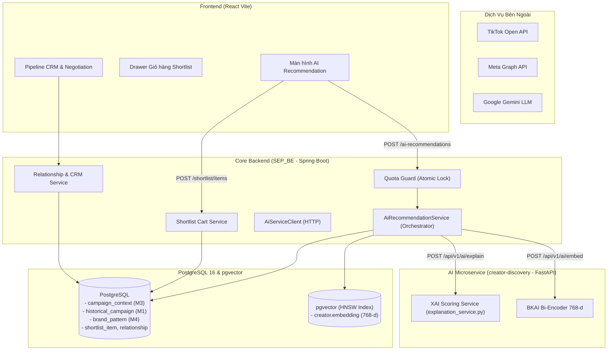
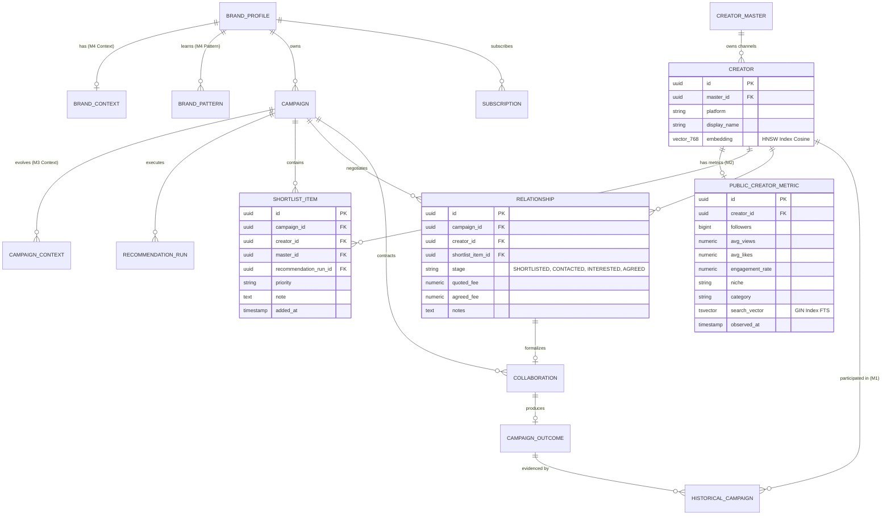
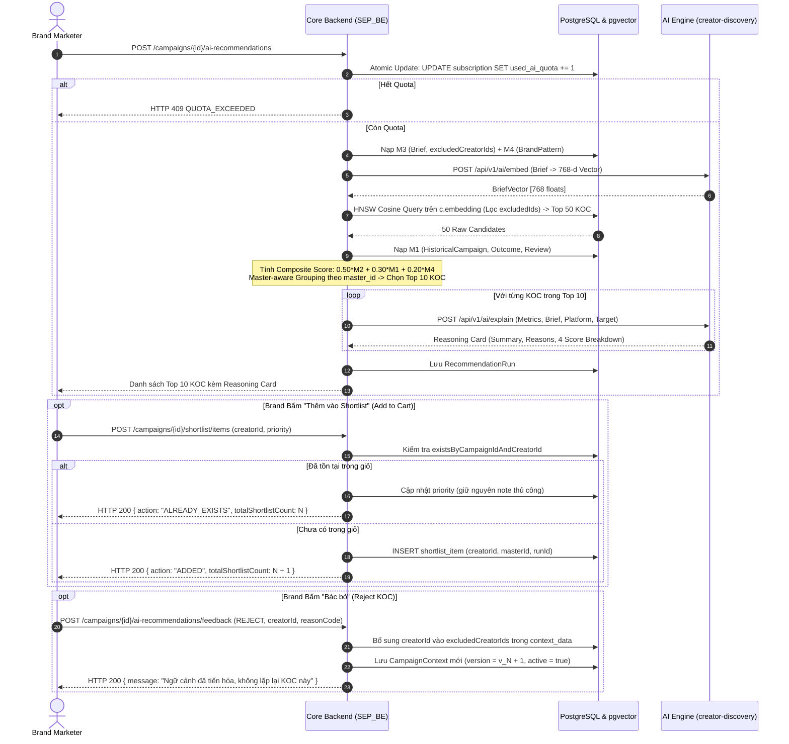

# 🧠 FLOW 3: AI RECOMMENDATION, FOUR-MEMORY RANKING & SHORTLIST CART SPECIFICATION
## InfluencerMatch AI – Core Intelligence & Collaboration Pipeline

> **Tài liệu đặc tả kỹ thuật, công thức định lượng & checklist triển khai chi tiết**  
> **Repository áp dụng:** `D:\SEP_BE` (Core Backend) & `D:\creator-discovery` (AI Microservice)  
> **Phiên bản:** v3.0 (Production-Grade Four-Memory Architecture & Idempotent Shortlist Cart)  
> **Mục tiêu cốt lõi:** Kết nối trí tuệ nhân tạo (Explainable AI) với hệ thống quản trị quan hệ KOC (CRM) qua chu trình khép kín: Đề xuất $\rightarrow$ Giỏ hàng ứng viên $\rightarrow$ Đàm phán $\rightarrow$ Hợp tác $\rightarrow$ Đúc kết tri thức.

---

## 📑 MỤC LỤC
1. [Workflow Nghiệp Vụ Tổng Thể 6 Giai Đoạn](#1-workflow-nghiệp-vụ-tổng-thể-6-giai-đoạn)
2. [Hệ Thống Chấm Điểm Đề Xuất Chiến Dịch (Scoring Formulas)](#2-hệ-thống-chấm-điểm-đề-xuất-chiến-dịch)
3. [Kiến Trúc Four-Memory Composite Ranking](#3-kiến-trúc-four-memory-composite-ranking)
4. [Cơ Chế Shortlist Cart ("Add to Cart" UX)](#4-cơ-chế-shortlist-cart-add-to-cart-ux)
5. [Feedback Loop & Tiến Hóa Bối Cảnh (Negative Constraints)](#5-feedback-loop--tiến-hóa-bối-cảnh)
6. [Hệ Thống Sơ Đồ Thiết Kế SRS/SDD (Mermaid Diagrams)](#6-hệ-thống-sơ-đồ-thiết-kế-srssdd)
7. [Checklist Triển Khai Chi Tiết 8 Tầng Kỹ Thuật](#7-checklist-triển-khai-chi-tiết-8-tầng-kỹ-thuật)
8. [Ma Trận Kiểm Thử Tự Động (Testing Suite)](#8-ma-trận-kiểm-thử-tự-động)
9. [Phân Công Trách Nhiệm Dự Án (RACI Matrix)](#9-phân-công-trách-nhiệm-dự-án)

---

## 1. WORKFLOW NGHIỆP VỤ TỔNG THỂ 6 GIAI ĐOẠN

Quy trình nghiệp vụ xuyên suốt từ lúc Brand đưa ra Brief cho đến khi chiến dịch kết thúc và hệ thống học hỏi kinh nghiệm:

```
[1. AI Recommendation] (Match Score & Reasoning Card)
          │
          ▼
[2. Add to Shortlist] (Candidate Cart - Brand lưu ứng viên tiềm năng)
          │
          ▼
[3. Review & Compare] (So sánh side-by-side, chọn Platform Account)
          │
          ▼
[4. Contact Selected] (Outreach Invitation - Xác minh Contact Readiness)
          │
          ▼
[5. CRM / Negotiation] (Thương lượng giá, Deliverables, chốt Agreed Fee)
          │
          ▼
[6. Collaboration & Learning] (Triển khai, nghiệm thu KPI, đúc kết M1 & M4)
```

### Phân định ranh giới 3 thực thể nghiệp vụ độc lập:
* **`ShortlistItem`**: Brand đang cân nhắc ai (lưu trữ nội bộ, KOC chưa hề biết).
* **`Relationship`**: Brand đang liên hệ và thương lượng với ai (phễu CRM từ `SHORTLISTED` $\rightarrow$ `CONTACTED` $\rightarrow$ `INTERESTED` $\rightarrow$ `AGREED`).
* **`Collaboration`**: Hợp đồng thực tế hai bên đã thống nhất điều kiện (deliverables, deadline, thanh toán).

---

## 2. HỆ THỐNG CHẤM ĐIỂM ĐỀ XUẤT CHIẾN DỊCH

Toàn bộ các chỉ số định lượng được chuẩn hóa trên thang điểm $[0.0, 100.0]$.

### 2.1. Điểm Quy Mô Phân Khúc (`followerScore` dùng hàm $\log_{10}$)
Khắc phục hiện tượng phạt dốc rớt về 0 bằng cơ chế phạt phi đối xứng (Asymmetric Penalty):
* **Trường hợp có khoảng mục tiêu $[\text{TargetMin}, \text{TargetMax}]$**:
  * Đạt chuẩn ($\text{TargetMin} \le \text{Followers} \le \text{TargetMax}$):
    $$\text{followerScore} = 100.0$$
  * Thiếu hụt ($\text{Followers} < \text{TargetMin}$):
    $$\text{followerScore} = \max\left(0.0, 100.0 - [\log_{10}(\text{TargetMin}) - \log_{10}(\text{Followers})] \times 50\right)$$
  * Vượt mức ($\text{Followers} > \text{TargetMax}$): Phạt nhẹ vì KOC lớn vẫn mang lại độ phủ tốt:
    $$\text{followerScore} = \max\left(60.0, 100.0 - [\log_{10}(\text{Followers}) - \log_{10}(\text{TargetMax})] \times 30\right)$$
* **Trường hợp có 1 mục tiêu cố định ($\text{Target}$)**:
  * Khớp chuẩn: $100.0$ điểm.
  * Thiếu hụt: $\max(0.0, 100.0 - [\log_{10}(\text{Target}) - \log_{10}(\text{Followers})] \times 50)$.
  * Vượt mức: $\max(50.0, 100.0 - [\log_{10}(\text{Followers}) - \log_{10}(\text{Target})] \times 30)$.
* **Trường hợp không đặt mục tiêu (Điểm sàn theo Tier)**:
  * Micro ($10\text{k} - 100\text{k}$): **$95.0$** | Mega ($> 1\text{M}$): **$90.0$** | Macro ($100\text{k} - 1\text{M}$): **$85.0$** | Nano ($< 10\text{k}$): **$75.0$**.
  * Nếu Brief nhắc trực tiếp tên Tier $\rightarrow$ Thưởng **$100.0$** điểm.
* *An toàn số học*: Bắt buộc bọc `fl = max(1, followers)` để tránh lỗi $\log_{10}(0)$.

### 2.2. Điểm Tương Tác (`engagementScore`)
Tách biệt bản chất phân phối nội dung giữa Video ngắn và MXH truyền thống:
* **Nhóm Video ngắn (TikTok, Reels, Shorts)**:
  $$\text{ER}_{\text{views}} = \frac{\text{avgLikes} + \text{avgComments} + \text{avgShares}}{\text{avgViews}} \times 100\%$$
  $$\text{engagementScore} = \min\left(100.0, \frac{\text{ER}_{\text{views}}}{5.0\%} \times 100\right)$$
  *(Lấy mốc $5.0\%$ làm chuẩn ngành; nếu $\text{avgViews} \le 0$, tự động fallback sang tính theo Followers)*.
* **Nhóm Truyền thống (Facebook, Instagram, YouTube)**:
  $$\text{ER}_{\text{followers}} = \frac{\text{avgLikes} + \text{avgComments} + \text{avgShares}}{\text{Followers}} \times 100\%$$
  $$\text{engagementScore} = \min\left(100.0, \frac{\text{ER}_{\text{followers}}}{\text{Benchmark}_{\text{Tier}}} \times 100\right)$$
  *(Benchmark Tier: Nano $4.5\%$, Micro $3.0\%$, Macro $2.0\%$, Mega $1.2\%$)*.

### 2.3. Điểm Tương Đồng Ngữ Nghĩa (`semanticMatchScore` với Min-Max Rescaling)
Khắc phục hiện tượng bão hòa Cosine (Score Saturation) của vector BKAI Bi-Encoder 768 chiều tiếng Việt:
$$\text{semanticMatchScore} = \text{round}\left(\frac{\text{Cosine} - 0.30}{0.85 - 0.30} \times 100, 1\right)$$
* $\text{Cosine} \le 0.30 \rightarrow \text{Score} = 0.0$ điểm.
* $\text{Cosine} \ge 0.85 \rightarrow \text{Score} = 100.0$ điểm.
* Ví dụ: $\text{Cosine} = 0.75 \rightarrow 81.8$ điểm; $\text{Cosine} = 0.65 \rightarrow 63.6$ điểm; $\text{Cosine} = 0.55 \rightarrow 45.5$ điểm.

### 2.4. Điểm Khớp Lĩnh Vực / Danh Mục (`nicheMatchScore`)
* **Exact Niche Match**: Trùng ngách trực tiếp trong Brief $\rightarrow$ **$100.0$ điểm**.
* **Top Tag Match**: Trùng hashtag nổi bật của KOC trong Brief $\rightarrow$ **$90.0$ điểm**.
* **Category Match**: Trùng danh mục tổng trong Brief $\rightarrow$ **$85.0$ điểm**.
* **Semantic Related Match** ($\text{Cosine} \ge 0.65$): $\text{Cosine} \times 100$.
* **Partial Semantic Match** ($0.40 \le \text{Cosine} < 0.65$): $\text{Cosine} \times 100$.
* **Out-of-niche** ($\text{Cosine} < 0.40$): $\max(20.0, \text{Cosine} \times 100)$ (Sàn bảo vệ $20.0$).

---

## 3. KIẾN TRÚC FOUR-MEMORY COMPOSITE RANKING

Java Backend (`SEP_BE`) là **Single Source of Truth** duy nhất quyết định điểm số và thứ hạng cuối cùng:

### 3.1. Công thức Xếp Hạng Đa Tầng (Composite Match Score)
$$\text{FinalScore} = 0.50 \times \text{Score}_{M2} + 0.30 \times \text{Score}_{M1} + 0.20 \times \text{Score}_{M4}$$

* **$\text{Score}_{M2}$ (Public Creator Match)**:
  $$\text{Score}_{M2} = 0.20 \times \text{followerScore} + 0.25 \times \text{engagementScore} + 0.30 \times \text{semanticMatchScore} + 0.25 \times \text{nicheMatchScore}$$
* **$\text{Score}_{M1}$ (Historical Reliability)**:
  * Đọc từ bảng `historical_campaign`, `campaign_outcome`, `creator_review`.
  * Tính dựa trên: Điểm đánh giá chất lượng của Brand (`brand_fit_rating` / 5.0), ý định hợp tác tiếp (`would_collaborate_again = true`), và ROI thực tế.
  * KOC mới chưa có lịch sử nhận điểm trung tính **$50.0$ điểm** (không bị phạt oan).
* **$\text{Score}_{M4}$ (Brand Preference Match)**:
  * Đọc từ bảng `brand_pattern`.
  * So khớp mức ER thực tế với `preferred_engagement_rate`, mức thù lao ước tính với `average_agreed_fee`. Nếu nằm trong dải tối ưu của Brand $\rightarrow$ Đạt điểm cao.

### 3.2. Master-aware Grouping (Khử Trùng Lặp KOC Đa Kênh)
* Dữ liệu ứng viên được nhóm theo: `COALESCE(c.master_id, c.id)`.
* Nếu 1 KOC có cả kênh TikTok (100k followers) và kênh Instagram (80k followers) cùng lọt vào danh sách lọc thô, hệ thống **chỉ chọn ra kênh có điểm tương thích cao nhất** để đưa vào danh sách đề xuất Top 10, tránh việc 1 người chiếm nhiều slot.

---

## 4. CƠ CHẾ SHORTLIST CART ("ADD TO CART" UX)

Xây dựng trải nghiệm chọn KOC mượt mà như giỏ hàng thương mại điện tử:

* **1-Click Thao Tác Nhanh**: Bấm *"Thêm vào Shortlist"*, hệ thống phản hồi ngay Toast: *"Đã thêm Trang Đào vào Giỏ Shortlist"* và cập nhật huy hiệu số lượng trên Navbar: `Giỏ ứng viên (6)`.
* **Idempotent Ở Database (Chống lỗi 409)**:
  * Nếu KOC đã có trong Shortlist của Campaign $\rightarrow$ Không ném ngoại lệ `RESOURCE_ALREADY_EXISTS`.
  * Giữ nguyên `note` cá nhân Brand đã viết trước đó, cập nhật `priority` nếu có truyền vào.
  * Trả về HTTP 200: `{ "action": "ALREADY_EXISTS", "totalShortlistCount": 6 }`.
* **Ghi Nhớ Bối Cảnh Đề Xuất**:
  * Mỗi lần thêm vào Shortlist đều lưu vết `recommendation_run_id` để Brand có thể xem lại KOC này được AI chấm bao nhiêu điểm ở thời điểm đó.
* **Quick Undo / Remove from Cart**:
  * Cho phép bấm icon thùng rác/bỏ chọn ngay trên thẻ KOC để xóa khỏi giỏ và trả về `totalShortlistCount` mới.

---

## 5. FEEDBACK LOOP & TIẾN HÓA BỐI CẢNH (NEGATIVE CONSTRAINTS)

### 5.1. Chính Sách Xử Lý Khi Brand REJECT KOC
* **Hành động bắt buộc**: Bổ sung `creatorId` vào mảng JSON `excludedCreatorIds` trong `CampaignContext.contextData`. Lần bấm đề xuất tiếp theo sẽ tự động loại trừ KOC này qua câu query: `WHERE c.id NOT IN (:excludedIds)`.
* **Ghi nhận tín hiệu mềm**: Lưu `reasonCode` (`PRICE_TOO_HIGH`, `OUT_OF_NICHE`, `STYLE_MISMATCH`) vào `feedbackHistory` để M4 phân tích xu hướng dài hạn.
* **Quy tắc bảo vệ**: **TUYỆT ĐỐI KHÔNG tự động hạ `budgetMax` hay xóa `niches` của chiến dịch!** Việc Brand chê 1 KOC đắt không có nghĩa là muốn giảm ngân sách của toàn bộ chiến dịch. Muốn đổi ràng buộc cứng, Brand phải chủ động chỉnh sửa trong bộ lọc Campaign.

### 5.2. Tiến Hóa Phiên Bản Ngữ Cảnh An Toàn
* Chuyển trạng thái bản ghi cũ: `active = false`.
* Tạo bản ghi mới: `CampaignContext` với `contextVersion = oldVersion + 1`, `active = true`, `updatedAt = NOW()`.
* Áp dụng khóa lạc quan (Optimistic Locking) trên `CampaignContext` chống ghi đè khi nhiều thành viên cùng đánh giá KOC trong một chiến dịch.

---

## 6. HỆ THỐNG SƠ ĐỒ THIẾT KẾ SRS/SDD

### 6.1. Sơ đồ Tổng quan Hệ thống (System Overview)


### 6.2. Sơ đồ Thực thể Dữ liệu Four-Memory (Logical ERD)


### 6.3. Sơ đồ Tuần tự Chi tiết (Sequence Diagram)


---

## 7. CHECKLIST TRIỂN KHAI CHI TIẾT 8 TẦNG KỸ THUẬT

### 🔴 Ưu tiên P0: Sửa lỗi kiến trúc & bảo vệ toàn vẹn dữ liệu
- [ ] **P0.1. Sửa câu Native Query pgvector chuẩn xác trong [PublicCreatorMetricRepository.java](file:///d:/SEP_BE/src/main/java/com/influencermatch/backend/creator/repository/PublicCreatorMetricRepository.java)**:
  - Bắt buộc trỏ vào cột **`c.embedding`** (bảng `creator`), KHÔNG trỏ vào `m.search_vector`.
  - Bổ sung mệnh đề loại trừ: `WHERE (:excludedIds IS NULL OR c.id NOT IN (:excludedIds))`.
  - Lọc lấy bản ghi metrics mới nhất qua subquery `observed_at DESC LIMIT 1`.
- [ ] **P0.2. Cài đặt Two-Phase Quota Reservation trong [SubscriptionService.java](file:///d:/SEP_BE/src/main/java/com/influencermatch/backend/billing/service/SubscriptionService.java)**:
  - Tạo atomic update: `UPDATE subscription SET usedRecommendationQuota = usedRecommendationQuota + 1 WHERE id = :id AND usedRecommendationQuota < quotaLimit`.
  - Cài đặt hàm `releaseQuotaReservation(UUID subId)` để hoàn quota nếu AI Engine lỗi.
- [ ] **P0.3. Xây dựng Four-Memory Feature Scorer trong `AiRecommendationService.java`**:
  - Tích hợp điểm $M_2$ (Semantic, Follower $\log_{10}$, ER chuẩn $5.0\%$, Niche dynamic).
  - Tích hợp điểm $M_1$ (Historical Reliability từ `HistoricalCampaign`).
  - Tích hợp điểm $M_4$ (Brand Preference Match từ `BrandPattern`).
  - Đảm bảo Java Backend là nơi duy nhất quyết định `finalMatchScore` và thứ hạng Top 10.
- [ ] **P0.4. Tạo JPA Entity & Repository cho M1 & M4**:
  - Tạo `HistoricalCampaign.java` (`@ManyToOne` với `CampaignOutcome`) và `HistoricalCampaignRepository.java`.
  - Tạo `BrandPattern.java` và `BrandPatternRepository.java`.

### 🟡 Ưu tiên P1: Hoàn thiện Shortlist Cart & Feedback Loop
- [ ] **P1.1. Xóa bỏ hoàn toàn lỗi 409 trong [ShortlistServiceImpl.java](file:///d:/SEP_BE/src/main/java/com/influencermatch/backend/relationship/service/ShortlistServiceImpl.java)**:
  - Nếu KOC đã có trong Shortlist $\rightarrow$ Trả về `ALREADY_EXISTS` và `totalShortlistCount`, giữ nguyên note thủ công của Brand.
  - Lưu kèm `master_id` và `recommendation_run_id` vào `ShortlistItem`.
- [ ] **P1.2. Master-aware Grouping trong `AiRecommendationService.java`**:
  - Nhóm 50 ứng viên thô theo `COALESCE(c.master_id, c.id)`. Mỗi Master KOC chỉ chọn ra 1 kênh có điểm số cao nhất.
- [ ] **P1.3. Cài đặt Endpoint Feedback và Negative Constraints Adaptation**:
  - `POST /campaigns/{id}/ai-recommendations/feedback`.
  - Khi Reject: CHỈ thêm `creatorId` vào `excludedCreatorIds` trong `CampaignContext` ($v_N \rightarrow v_{N+1}$).
  - **Tuyệt đối không tự ý sửa `budgetMax` hay xóa `niches`** của chiến dịch.
- [ ] **P1.4. Tích hợp HTTP Client `AiServiceClient.explainRecommendation`**:
  - Kết nối với FastAPI `POST /api/v1/ai/explain`.
  - Bổ sung Circuit Breaker fallback với cờ `explanationAvailable = false` khi Python timeout.

### 🟢 Ưu tiên P2: Nâng cấp trải nghiệm người dùng & Tối ưu hóa
- [ ] **P2.1. API đếm nhanh giỏ hàng**:
  - `GET /campaigns/{id}/shortlist/count` phục vụ cập nhật badge trên Navbar.
- [ ] **P2.2. API Quick Undo**:
  - `DELETE /campaigns/{id}/shortlist/creators/{creatorId}` cho phép bỏ chọn ngay trên thẻ KOC.
- [ ] **P2.3. Tinh chỉnh Python AI Microservice (`creator-discovery`)**:
  - Đảm bảo `_calculate_follower_score()` chạy đúng công thức $\log_{10}$ phi đối xứng.
  - Đảm bảo `_calculate_engagement_score()` chuẩn hóa video ngắn theo mốc $5.0\%$.
  - Đảm bảo `_calculate_semantic_score()` áp dụng Min-Max Rescaling dải $[0.30, 0.85]$.

---

## 8. MA TRẬN KIỂM THỬ TỰ ĐỘNG

| Mã Test | Kịch bản kiểm thử (Test Scenario) | Kết quả kỳ vọng |
| :---: | :--- | :--- |
| **TEST-01** | Bắn đồng thời 2 request khi chỉ còn 1 lượt Quota | Chỉ 1 request thành công, request thứ hai nhận HTTP 409 `QUOTA_EXCEEDED`. |
| **TEST-02** | Python AI Service bị timeout hoặc tắt server | Backend tự động giải phóng Quota tạm giữ, không làm mất lượt của Brand. |
| **TEST-03** | Chạy truy vấn Vector Search trên Database | SQL chạy thành công trên cột `c.embedding`, không bị lỗi kiểu dữ liệu `tsvector`. |
| **TEST-04** | Một KOC có cả kênh TikTok và Instagram điểm cao | Danh sách Top 10 chỉ hiển thị 1 kênh đại diện tốt nhất của KOC đó. |
| **TEST-05** | Bấm *"Thêm vào Shortlist"* 2 lần liên tiếp trên 1 KOC | Trả về `ALREADY_EXISTS`, không bị lỗi 409, giữ nguyên ghi chú cá nhân của Brand. |
| **TEST-06** | Brand Reject KOC với lý do `PRICE_TOO_HIGH` | KOC được đưa vào `excludedCreatorIds`, lần chạy sau không xuất hiện, ngân sách Campaign giữ nguyên. |

---

## 9. PHÂN CÔNG TRÁCH NHIỆM DỰ ÁN (RACI MATRIX)

| Thành viên | Vai trò | Trách nhiệm chính trong Flow 3 | Module bàn giao |
| :--- | :--- | :--- | :--- |
| **Khải** | Backend Lead | • Sửa query pgvector `c.embedding`<br>• Viết Quota Reservation & Rollback<br>• Xây dựng Four-Memory Ranking Engine<br>• Cài đặt Shortlist Cart Idempotent & Feedback Endpoint | `SubscriptionService.java`<br>`PublicCreatorMetricRepository.java`<br>`AiRecommendationService.java`<br>`ShortlistServiceImpl.java` |
| **Vy** | AI Lead | • Kiểm chuẩn 4 công thức toán học trong `explanation_service.py`<br>• Khớp nối DTO API `/api/v1/ai/explain` với Java Client<br>• Viết logic Fallback khi service AI quá tải | `explanation_service.py`<br>`ai_router.py` |
| **Văn** | Frontend Lead | • Xây dựng UI Thẻ đề xuất KOC kèm Reasoning Card Modal<br>• Cài đặt nút 1-Click *"Thêm vào Shortlist"* kèm Toast thông báo<br>• Xây dựng Drawer *"Giỏ hàng KOC"* và Huy hiệu đếm số lượng | `RecommendationView.tsx`<br>`ShortlistCartDrawer.tsx`<br>`ReasoningCardModal.tsx` |
| **Ngọc** | Data Lead | • Đảm bảo Crawler cào đủ `avgViews`, `avgLikes` vào `public_creator_metric`<br>• Giám sát việc sinh vector 768 chiều vào cột `creator.embedding` | `java_mapper.py`<br>`tiktok_crawler.py` |
