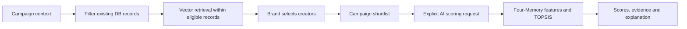

# Campaign creator search and shortlist scoring



## 1. Search is database retrieval

The shared ingestion/search contract is `src/main/resources/contracts/creator-discovery-v1.json`.
The crawler packages an identical generated copy in `app/contracts/`. Backend ingestion,
discovery aliases, follower admission, snapshot size, and crawler category seeds read this
contract. `GET /taxonomies/creator-discovery-contract` exposes its version and rules.
`category` is a broad code; `niche` holds observed labels, including custom labels. A known
specific niche takes precedence over a contradictory coarse category (e.g. BEAUTY + Gia dụng
becomes HOME). Multi-category niche labels are preserved. Crawl seed/configuration is never
used to invent an observed label. Unknown recrawls clear stale labels; manager-reviewed
category, niche, and creator type are preserved together.
An exact known category/niche code or alias in `keyword` is a hard taxonomy filter as well:
`FOOD`, `Ẩm thực`, and `Thực phẩm & Nấu ăn` retrieve the same eligible industry even when
the stored label is canonicalized and query embeddings are unavailable. Other keywords keep
content/name search behavior. Explicit UI filters continue to apply alongside taxonomy keywords.
An explicit niche or taxonomy keyword supplies category context for a draft without campaign
niches; a generic draft title/product placeholder is not an extra required content phrase.
Ingestion and discovery choose the same latest snapshot (`collected_at`, then UUID), including
legacy accounts that have several metric rows.

New creator admission and all discovery stages require at least 5,000 followers. Existing
creators can still refresh below that floor. The newest three posts supply both exported
metrics and stored post evidence. ER in payloads, storage, discovery responses, and minEr/maxEr
filters is a ratio (`0.05` means 5%). Versioned payloads declare `engagementRateUnit=RATIO`;
explicit PERCENT input is converted once. Legacy crawler input without a unit is recomputed
from measured likes/comments/shares and followers when available. Invalid units, versions,
non-finite/wrong-size embeddings, and inconsistent versioned ER are rejected before writes.
Duplicate-run SKIPPED acknowledgements with a creator ID count as successful synchronization.

The Python synchronization tool lives in the crawler repository. Run from that checkout:

```powershell
python scripts/sync_discovery_contract.py --backend-root 'C:\InfluencerMatch\backend'
python scripts/sync_discovery_contract.py --backend-root 'C:\InfluencerMatch\backend' --check
```

V57 is generated by that command and repairs unreviewed legacy category contradictions and
whole-label aliases. Reviewed classifications remain untouched. Deploy the backend migrations
and backend first, then restart crawler API/workers with the matching packaged contract.
Do not rewrite an already-applied migration for a future contract revision; create a new version.
The ingestion/search integration test consumes actual Python JavaMapper output from
`src/test/resources/contracts/crawler-discovery-fixtures.json`. Re-export/check it from the
crawler checkout after mapper changes:

```powershell
python scripts/export_discovery_contract_fixture.py --output 'C:\InfluencerMatch\backend\src\test\resources\contracts\crawler-discovery-fixtures.json'
python scripts/export_discovery_contract_fixture.py --output 'C:\InfluencerMatch\backend\src\test\resources\contracts\crawler-discovery-fixtures.json' --check
```

`GET /campaigns/{id}/discover` and `GET /campaigns/{id}/discovery` share
`CreatorDiscoveryService`. Their response shapes remain `data.items` and
`data.content`. Discovery may generate a query embedding and compare it with stored Creator vectors. It does not run Four-Memory/TOPSIS, explanations, or consume recommendation quota.

Filter the latest ingested snapshot (`collected_at`, then UUID) to FRESH KOL/KOC.
An older accepted snapshot cannot override a newer rejection or stale snapshot.
Campaign platform, observed niche/category, location and follower constraints stay
in force; UI filters narrow them. Crawl configuration is not niche evidence.
Whole niche labels and explicit aliases match, including comma-separated labels.
Aliases include crawler `TECH` / legacy `TECHNOLOGY` and the crawler food labels
`Thực phẩm & Đồ uống`, `Thực phẩm & Nấu ăn`, and `Ăn uống`. Product-topic inference
must not expand an explicitly selected category into a different category family.

When campaign niches are absent, require lexical product evidence in public
content, using productService, then the name/brief for incomplete drafts. This is
conservative and can miss synonyms; it must not dump the catalogue. Empty topic
means empty results. No unrelated profiles are added to fill 50 slots.

Broad categories alone are insufficient for a known product subtopic. Sunscreen,
skincare, haircare and makeup terms impose their corresponding observed niche or
product-content constraint in addition to campaign filters. For example, BEAUTY
plus sunscreen does not admit a hair salon, household reviewer or personal-care
account solely because its coarse category is BEAUTY. Product text takes priority
over the campaign title when identifying a supported subtopic. Responses identify
this filtering policy as discoveryPolicyVersion=progressive-v4; clients must not
substitute legacy broad/AI fallback responses for that policy.

Keyword search uses PostgreSQL websearch_to_tsquery across channel name/username
and public content, including stored post captions. Sparse imported summaries such
as "Creator" do not prevent real post evidence from qualifying a profile. Supported
product subtopics use explicit concept phrases and synonyms for eligibility and
default lexical ranking; they do not require every marketing qualifier in a long
product description. User-entered multiword searches still require all words.
Context/UI eligibility is materialized before cosine similarity is computed. Default retrieval rank combines 60% nonnegative cosine similarity and 40% lexical rank. Missing/invalid query embeddings fall back to lexical rank without relaxing filters. Stable follower/UUID tie breakers apply. Collapse linked
channels by CreatorMaster before taking Top 50, then paginate the same window.

Vector retrieval rank is not a Four-Memory/TOPSIS match percentage. The /discovery response reports
aiScoreAvailable=false and unavailable semanticScore/hybridScore/matchScore/score/finalScore
(null fields may be omitted by serialization). /discover returns public metrics without AI score fields.
retrievalMethod identifies VECTOR_HYBRID or LEXICAL; retrievalSimilarity is the raw cosine value when available. searchRank is the retrieval ranking value, while ftsScore is lexical relevance only. Legacy SEMANTIC_RELEVANCE sorting preserves retrieval order.
The frontend should label this stage as filtering/search relevance, not AI scoring.

## 2. Shortlist records the Brand's selection

`POST /campaigns/{id}/shortlist` and batch endpoints save selected creator accounts.
Adding an item does not run recommendation or charge AI quota. Existing background
refresh can update public metrics. Brand selection is the candidate boundary for
later scoring; rejected/removed shortlist items are not sourced from the catalogue.

## 3. AI scores only shortlisted creators

`POST /campaigns/{id}/ai-recommendations` uses SHORTLIST, including service overloads
that omit a source. An empty active shortlist returns RECOMMENDATION_NO_CANDIDATES
before preparing scoring context, calling AI or reserving quota. DISCOVERY source
is rejected with 400; there is no automatic catalogue fallback.

After verifying the shortlist, load the frozen campaign/brand context and its
stored embedding. A pending embedding still produces the existing 409 status.
Read only non-REMOVED shortlist accounts, apply campaign eligibility and evidence
checks, and calculate the existing Four-Memory/TOPSIS scores. Preserve missing-data
warnings, provisional candidates, per-platform pricing, grouping and display modes.
Quota reservation/release and persisted run snapshots remain in the scoring stage;
new runs always record candidateSource=SHORTLIST. Historical runs are not rewritten.

## Verification

DiscoveryPostgresIntegrationTest exercises real HTTP handlers and disposable
PostgreSQL/pgvector: sunscreen versus pets/school supplies, missing niches, Vietnamese
aliases, rejected/stale latest snapshots, keywords, UI filters, master grouping,
Top 50 vector ordering within context filters, no discovery recommendation scoring, and empty-shortlist/source rejection with
no scoring quota or run created. Existing recommendation unit suites verify the
scoring formulas against explicit shortlist fixtures. CampaignM3 and BrandM4
integration suites verify context/embedding provenance and quota behavior.
