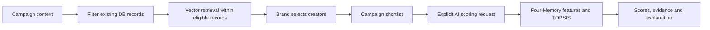

# Campaign creator search and shortlist scoring

## 1. Search is database retrieval

`GET /campaigns/{id}/discover` and `GET /campaigns/{id}/discovery` share
`CreatorDiscoveryService`. Their response shapes remain `data.items` and
`data.content`. Discovery may generate a query embedding and compare it with stored Creator vectors. It does not run Four-Memory/TOPSIS, explanations, or consume recommendation quota.

Filter the latest ingested snapshot (`collected_at`, then UUID) to FRESH KOL/KOC.
An older accepted snapshot cannot override a newer rejection or stale snapshot.
Campaign platform, observed niche/category, location and follower constraints stay
in force; UI filters narrow them. Crawl configuration is not niche evidence.
Whole niche labels and explicit aliases match, including comma-separated labels.

When campaign niches are absent, require lexical product evidence in public
content, using productService, then the name/brief for incomplete drafts. This is
conservative and can miss synonyms; it must not dump the catalogue. Empty topic
means empty results. No unrelated profiles are added to fill 50 slots.

Broad categories alone are insufficient for a known product subtopic. Sunscreen,
skincare, haircare and makeup terms impose their corresponding observed niche or
product-content constraint in addition to campaign filters. For example, BEAUTY
plus sunscreen does not admit a hair salon, household reviewer or personal-care
account solely because its coarse category is BEAUTY. Product text takes priority
over the campaign title when identifying a supported subtopic. Responses identify
this filtering policy as discoveryPolicyVersion=context-db-v2; clients must not
substitute legacy broad/AI fallback responses for that policy.

Keyword search uses PostgreSQL websearch_to_tsquery across channel name/username
and public content. Ordinary multiword queries require all words. Context/UI eligibility is materialized before cosine similarity is computed. Default retrieval rank combines 60% nonnegative cosine similarity and 40% lexical rank. Missing/invalid query embeddings fall back to lexical rank without relaxing filters. Stable follower/UUID tie breakers apply. Collapse linked
channels by CreatorMaster before taking Top 50, then paginate the same window.

Vector retrieval rank is not a Four-Memory/TOPSIS match percentage. The /discovery response reports
aiScoreAvailable=false and unavailable semanticScore/hybridScore/matchScore/score/finalScore
(null fields may be omitted by serialization). /discover returns public metrics without AI score fields.
retrievalMethod identifies VECTOR_HYBRID or LEXICAL; retrievalSimilarity is the raw cosine value when available. searchRank is the retrieval ranking value, while ftsScore is lexical relevance only. Legacy SEMANTIC_RELEVANCE sorting preserves retrieval order.
The frontend should label this stage as filtering/search relevance, not AI scoring.

## 2. Shortlist records the Brand's selection

`POST /campaigns/{id}/shortlist` and batch endpoints save selected creator accounts.
Adding an item does not run recommendation or charge AI quota. Existing background
refresh can update public metrics. Brand selection is the candidate boundary for
later scoring; rejected/removed shortlist items are not sourced from the catalogue.

## 3. AI scores only shortlisted creators

`POST /campaigns/{id}/ai-recommendations` uses SHORTLIST, including service overloads
that omit a source. An empty active shortlist returns RECOMMENDATION_NO_CANDIDATES
before preparing scoring context, calling AI or reserving quota. DISCOVERY source
is rejected with 400; there is no automatic catalogue fallback.

After verifying the shortlist, load the frozen campaign/brand context and its
stored embedding. A pending embedding still produces the existing 409 status.
Read only non-REMOVED shortlist accounts, apply campaign eligibility and evidence
checks, and calculate the existing Four-Memory/TOPSIS scores. Preserve missing-data
warnings, provisional candidates, per-platform pricing, grouping and display modes.
Quota reservation/release and persisted run snapshots remain in the scoring stage;
new runs always record candidateSource=SHORTLIST. Historical runs are not rewritten.

## Verification

DiscoveryPostgresIntegrationTest exercises real HTTP handlers and disposable
PostgreSQL/pgvector: sunscreen versus pets/school supplies, missing niches, Vietnamese
aliases, rejected/stale latest snapshots, keywords, UI filters, master grouping,
Top 50 vector ordering within context filters, no discovery recommendation scoring, and empty-shortlist/source rejection with
no scoring quota or run created. Existing recommendation unit suites verify the
scoring formulas against explicit shortlist fixtures. CampaignM3 and BrandM4
integration suites verify context/embedding provenance and quota behavior.
